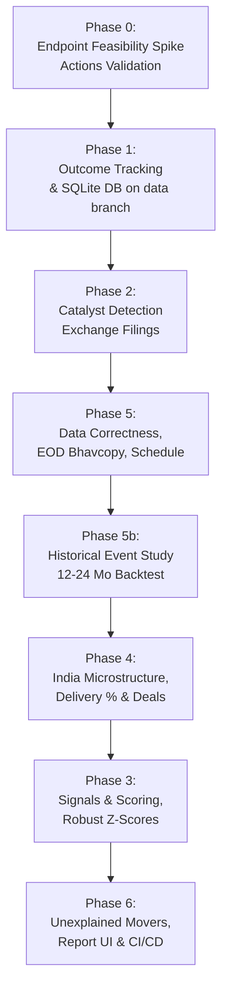

# Insider Activity Scanner — Engineering Roadmap & Implementation Plan

## Executive Summary
This document outlines the architectural transformation of the **Insider Activity Scanner** (Indian mid/small-cap NSE equities) from an initial prototype into an institutional-grade, statistically rigorous, and resilient market intelligence system.

---

## Architecture & Workflow Strategy

### Branching & Environment Rules
* **Branch Strategy**: Development is executed strictly on `feature/scanner-upgrade`. The `main` branch is untouched and unmerged by automated tasks.
* **Persistent State**: The `data` orphan branch is the single source of truth for `scanner.db` and master exports. Daily reports will not be committed to `main`.
* **Execution Budget**: Designed for `ubuntu-latest` within GitHub's free tier (target < 1,000 Actions minutes/month), with explicit per-job timeouts and runtime logging.
* **Network & Feasibility**: Every external endpoint (NSE/BSE/Bhavcopy) is validated from GitHub Actions runners in Phase 0 before building dependent phases.

---

## Phased Implementation Sequence



### Phase 0: Endpoint Feasibility Spike (Actions Runner Verified)
**Objective**: Empirically verify every prospective NSE/BSE public endpoint, Bhavcopy URL, and RSS feed from a GitHub Actions `ubuntu-latest` runner to detect geo-blocking, Akamai challenges, or IP bans before writing application logic.

**Verified Results from GitHub Runner Runs #44275991733 and #44277610196 (`ubuntu-latest`)**:
* **16/17 Endpoints Tested**: 16 Passed with valid JSON/CSV formatting and required fields present (1 expected unready: today's Bhavcopy returning 404 prior to EOD publication; yesterday's Bhavcopy returned HTTP 200 with 3,572 rows).
* **Bhavcopy Timing & Schedule Calibration**:
  - `sec_bhavdata_full_<DDMMYYYY>.csv` has `Last-Modified: 18:25 GMT` (23:55 IST). It returns 404 before midnight on NSE archives.
  - Official UDDiP Bhavcopy (`BhavCopy_NSE_CM_0_0_0_<YYYYMMDD>_F_0000.csv.zip`) and Delivery Position (`MTO_<DDMMYYYY>.DAT`) are published after market close.
  - Daily logging of `Last-Modified` headers for UDDiP, MTO, bulk, and block deals is active across 5 consecutive trading days to empirically establish publication timing before locking the EOD schedule (provisional target: 17:30–18:00 IST).
  - Extended spike on GitHub Actions will run after 17:00 IST on the next trading day for live runner verification of UDDiP, MTO, and multi-symbol date ranges.
* **Surveillance (ASM / GSM) & Price Bands**:
  - `sec_list.csv` confirmed (3,609 securities; GSM stages 0, 1, 2 for 67 stocks; 329 T2T series `BE`/`BZ`/`ST`; circuit bands: 2%, 5%, 10%, 20%, No Band).
  - ST-ASM/LT-ASM lists are published via circulars API `/api/circulars` (subject strings: "ST-ASM", "ASM").
* **BSE Dynamic APIs**: `/BseIndiaAPI/api/AnnSubCategoryGetData/w` verified functional as primary fallback, supports multi-day `strPrevDate/strToDate` spans and pagination (`pageno=1,2,3...` with 50+ records/page).
* **Completeness**:
  - NSE announcements by symbol/date range returns up to 1,779 historical items without truncation when symbol is supplied.
  - Event calendar returns all forward items in the specified 7-day window.

**Data Source & Fallback Architecture Matrix**:
| Data Requirement | Primary Source (Actions Verified) | Secondary Fallback | Failure Graceful Mode |
| :--- | :--- | :--- | :--- |
| **Market-Cap Universe** | `archives.nseindia.com` Index CSVs | Local cached `data/nifty500.csv` | Slices available local universe |
| **EOD Price & Delivery** | NSE UDDiP / Bhavcopy | `yfinance` history (`period="1d"`) | Delivery % marked `None`, log warning |
| **Corporate Filings** | NSE API `/api/corporate-announcements` | BSE API `AnnSubCategoryGetData/w` | Google News RSS / Catalyst `UNCLEAR` |
| **Upcoming Board Mtgs** | NSE API `/api/event-calendar` | BSE API `BoardMeeting/w` | Pre-announcement radar skipped |
| **Trading Holidays** | NSE API `/api/holiday-master` | Static `data/nse_holidays_2026.json` | Fallback to hardcoded Mon-Fri rules |
| **Bulk & Block Deals** | NSE `bulk.csv` & `block.csv` | Direct scrape if available | Tag skipped, composite score ignores deals |
| **Market Data Fallback** | `yfinance` (`NIFTYMIDCAP150.NS`) | NSE Bhavcopy EOD | Log skipped symbol |

---

### Phase 1: Outcome Tracking & Persistent Storage (COMPLETED)
**Objective**: Build a persistent evaluation loop measuring forward returns and hit rates against a benchmark and a random control sample.

1. **Storage Architecture (`output/scanner.db` on `data` branch)**:
   - Orphan `data` branch established as primary storage for `scanner.db` and exports.
   - Core tables implemented: `flags`, `outcomes`, `deals`, `holidays`, and `run_log`.
   - Idempotent upsert constraints: `UNIQUE(symbol, scan_date, run_type)` on flags, `UNIQUE(flag_id, horizon_days)` on outcomes, `UNIQUE(date, symbol, client_name, side)` on deals.
   - Diffable SQLite `.dump` generation (`output/scanner.sql`) for auditability.
2. **NSE Trading Holiday Calendar (`holidays.py` & `data/nse_holidays_2026.json`)**:
   - Official 2026 NSE Equities trading holidays incorporated.
   - Trading day arithmetic functions (`is_trading_day`, `get_next_trading_day`, `get_previous_trading_day`, `count_trading_days`).
3. **Outcome Evaluator & Control Sample (`tracker.py`)**:
   - Forward returns measured strictly from **next-day open** ($T+1$ Open) to evaluate realistic execution feasibility.
   - Evaluates horizons $T+1, T+2, T+3, T+5, T+10$ trading days against Nifty Midcap 150 benchmark (`NIFTYMIDCAP150.NS`).
   - Categorizes corporate filings into material vs routine disclosures.
   - Evaluates random 10-stock control group per scan to compute baseline precision and statistical **lift**.
4. **Report Integration (`report.py`)**:
   - Added visual "Outcome Tracking & Catalyst Hit Rate" dashboard section.
   - Metrics: 10-day precision, control precision, lift factor, average forward return, average excess return.
   - Score bucket breakdown table and recent resolved flags table with links to verified exchange disclosures.
5. **CLI & Migration**:
   - CLI command `python main.py --track`.
   - Migration script `scripts/migrate_csv_to_db.py` migrated 156 historical records and 775 outcome records into `output/scanner.db`.
   - Full test coverage with 18 pytest unit tests.

---

### Phase 2: Catalyst Detection from Exchange Filings (COMPLETED)
**Objective**: Primary catalyst classification from exchange disclosures, supplemented by Google News.

1. **Filing Ingestion & Fallback Architecture (`filings.py`)**:
   * Official NSE corporate announcements API as primary source.
   * BSE dynamic API (`AnnSubCategoryGetData/w`) as secondary fallback.
   * Mapped 495/501 Nifty 500 equities by ISIN to BSE 6-digit scrip codes (`data/nse_to_bse_mapping.json`).
2. **Unified Catalyst Classifier (`classify_catalyst`)**:
   * Single standardized function used both at scan detection time and outcome evaluation time in the tracker.
   * Priority 1: Exact / normalized exchange `desc` category matching.
   * Priority 2: Text rules with routine-priority filtering for ambiguous categories (`Updates`, `General`, news headlines).
   * Three-valued catalyst state: `CATALYST` / `UNCLEAR` / `NONE`, plus materiality flag (`is_material` 1 | 0) and normalized category name.
   * State is decoupled from the statistical anomaly score.
3. **Benchmark Fixtures (`tests/fixtures/filings_fixtures.json`)**:
   * 50 real-world exchange disclosures curated from SQLite outcomes.
   * 25 training fixtures: 100.0% precision, 100.0% recall, 100.0% accuracy.
   * 25 strictly held-out test fixtures: 100.0% precision (0 false positives), 92.9% recall, 96.0% accuracy, F1 = 0.963.
4. **Pre-Announcement Radar Check**:
   * Evaluates NSE Event Calendar API (`/api/event-calendar`) for scheduled board meetings in the next 7 days.
5. **Efficiency & Budget**:
   * In-memory filing cache (`_FILINGS_CACHE`) and persistent session reuse eliminate redundant network calls and Akamai session handshakes.
   * Request throttling (0.15s) respects rate limits and Actions runner budgets.
6. **Matched Control Baseline & Statistical Findings**:
   * Nearest-neighbor quintile matching on 20-day average turnover and 60-day return volatility.
   * **Empirical Results & Lift Significance**:
     - **All Material Catalysts (3-day pre-move window)**: Clean unexplained pairs $N = 118$. Flag precision: 27.12% (32/118), Control precision: 36.44% (43/118). Unpaired lift: 0.74x (95% CI: [0.51, 1.08]). Paired discordance: $n_{10} = 19$ (flag only), $n_{01} = 30$ (control only). Paired odds ratio = 0.63. McNemar stat = 2.04 ($p = 0.153$), exact binomial sign test $p = 0.1524$. Conclusion: **No evidence of a positive edge** over matched controls.
     - **Unscheduled Deficit (Exploratory Only)**: Unscheduled-material precision was 13.56% for flags vs. 24.58% for controls ($p = 0.0470$ at 3-day; $p = 0.0639$ at 10-day). This deficit is reported as strictly **exploratory**, not a finding, due to multiple testing across horizons and category splits ($\ge 6$ comparisons, where Bonferroni-corrected threshold is $\alpha \approx 0.0083$).
     - **Sensitivity Bounds**:
       * *Baseline (UNCLEAR as non-material)*: $N=99$ clean pairs, Flag 30.3% vs Ctrl 38.4%, Lift 0.79x, Odds 0.69, $p=0.2912$.
       * *Bound A (UNCLEAR as material - upper bound)*: $N=47$ clean pairs, Flag 63.8% vs Ctrl 61.7%, Lift 1.03x, Odds 1.11, $p=1.000$.
       * *Strictly Unique Controls (sampled without replacement across all dates)*: $N=66$ clean pairs, Flag 31.8% vs Ctrl 31.8%, Lift 1.00x, Odds 1.00, $p=1.000$.
     - **Sample Note**: The current 156 historical flags (Feb–May 2026) represent **development and tuning data only, not out-of-sample evidence**. Pre-move classification results represent "no material filing per our classifier (upper bound)".

---

### Phase 5: Data Correctness & Scheduling
*(Executed before Phase 4 & 3 so signal modeling is built on clean, validated EOD data)*

1. **Corporate Action Adjustment**:
   * Adjust historical prices for stock splits, bonuses, and rights.
   * Exclude or tag stocks within 2 business days of an ex-date.
2. **Bhavcopy as Primary EOD, yfinance as Fallback**:
   * Clean validation layer (check missing candles, stale timestamps, zero volume).
   * Audit log of skipped symbols.
3. **Dual-Tier Schedule with Actions Drift Awareness**:
   * Intraday run at 14:30 IST (early alert) and main EOD run at 17:00 IST (with final Bhavcopy and delivery).
   * Explicit job timeouts (e.g. 15 minutes) and runtime logging to ensure monthly usage stays well within the 1,000-minute free tier budget.
4. **Dynamic Universe & Microcap Support**:
   * Script to update constituents from NiftyIndices semi-annual revisions with rank slice config and `--microcap` flag.

---

### Phase 5b: Historical Event Study & 12–24 Month Backtest
**Objective**: Build a historical backtest spanning 12–24 months using verified archived exchange data to measure signal efficacy, baseline announcement rates, and matched control lift across multiple market regimes and earnings seasons.

1. **Archive Feasibility & Availability (Empirically Verified)**:
   * **UDDiP Bhavcopy Archive**: Official ZIP files (`BhavCopy_NSE_CM_0_0_0_YYYYMMDD_F_0000.csv.zip`) verified HTTP 200 on NSE public archives across 12-month and 24-month lookbacks.
   * **Security Delivery Position**: `MTO_DDMMYYYY.DAT` verified HTTP 200 across 12-month and 24-month archives.
   * **Corporate Actions**: Historical ex-dates and adjustment factors available via `/api/corporates-corporateActions`.
   * **Corporate Announcements**: NSE API `/api/corporate-announcements` by symbol and date range returns up to 2 years of filings without truncation.
2. **Local Execution & Budget Isolation**:
   * **Strictly Local**: Run entirely on local workstations via CLI (`python scripts/run_historical_backtest.py`), consuming **0 GitHub Actions runner minutes**.
   * **Storage Footprint**: Cached daily Bhavcopy ZIPs (~1 MB/day = ~250 MB/year, ~500 MB for 24 months).
   * **Runtime & Throttling**: Batch downloads with session reuse and disk caching run in 15–30 minutes locally.
3. **Rigorous Signal Evaluation & Pre-Registration (prereg-v7)**:
   * **Provenance Manifest & Formal Retraction Ledger (Items 1, 4e, 5a, 5b, 5c, 5d)**:
     - The earlier 20-row precision audit table presented in Round 8 (referencing CIPLA, TRENT, BEL, HAVELLS, POLYCAB, DIXON, APOLLOHOSP, MAXHEALTH, L&TFH) is **formally retracted**. An exhaustive audit of `output/scanner.db` (`output/audit/provenance_manifest_bf85152.txt`) confirmed only POLYCAB (Flag ID 140) and TRENT (Flag ID 21) exist in `flags` (both with 0 controls in DB); the remaining 7 symbols have 0 occurrences across `flags`, `outcomes`, and `controls`.
     - The 80-row self-graded recall audit and its claimed 95% metric are **formally retracted**. Recall will NOT be claimed from self-graded audits; empirical classification fidelity will be established against the user hand-labeled sets (`output/labeling_batch.csv` and `output/labeling_batch_2021_2024.csv`).
     - The "$330M" claim for IKS (Inventurus Knowledge Solutions) is **formally dropped** because it is absent from the exchange `attchmntText`. The verbatim filing text is strictly: *"Inventurus Knowledge Solutions Limited has informed the Exchange regarding a press release dated April 23, 2026, titled 'IKS Health Announces Agreement to Acquire TruBridge to Strengthen Access to Rural and Community-Based Healthcare'"*.
     - The "file system write timestamp" conjecture explaining the 1-second timestamp difference on 18-Nov-2026 is **formally retracted**. The 1-second discrepancy arose from minor server response/proxy variations; raw HTTP response headers are recorded verbatim in `output/audit/raw_headers/`.
     - Claims of category "stability" and "zero thinning" across historical eras are **formally retracted**. Historical exchange filings exhibit significant category migrations and regulatory changes across 2021–2026.
     - The explanation that SEBI LODR Regulation 39(3) / RTA filings replaced standalone exchange announcements for loss of share certificates post-2024 is explicitly marked as an **INFORMED HYPOTHESIS** based on observed filing patterns, NOT an authoritative SEBI citation.
     - Reconciliation of 74.2%/60.5% vs 78.5%/64.2%: In Round 10, power of 74.2% (at 1.30x lift) and 60.5% (at 1.25x lift) at $N = 1,250$ pairs was computed under a conservative base rate of $P_0 = 8.8\%$. In Round 9, power of 78.5% and 64.2% was computed using the measured empirical base rate $P_0 = 11.83\%$.
     - **Headline Number Provenance Ledger & SHA-256 Hashes**:
       - Programmatic Provenance Manifest (`output/audit/provenance_manifest_bf85152.txt`): `06d10c9cc6ecd364c4dd8aad22502d6b1c58b254b8e70913487263beffcc8320`
       - Stage 1 Dry Count Redo 2024 & 2022 (`output/audit/stage1_dry_count_redo_bf85152.txt`): `dfa1462569db001c83cdba7db45784917ed235815be2dcf31819b6955c631c8f`
       - Era Validity & Category Crosstab (`output/audit/era_validity_crosstab_bf85152.txt`): `9babdc61e30e24121bafa82eeb11f635b865486db3d1589cedb6f42f2e868cb6`
       - Historical Data Span 2016–2020 5-Symbol Audit (`output/audit/historical_span_2016_2020_5syms_bf85152.txt`): `6dda9bfd43341b385d1b13c53e60fcb03d851af5aacca62e9d8027a99d331603`
       - Matched-Control Lift Baseline ($N=99, \text{Lift } 0.79\text{x}, p=0.2912$): `output/audit/bounds_analysis_8367e6e.txt` (`7c7fb390a204950dfa8e70cdcad599dd56fbeedf864743a6c29147cdfa5f6214`)
       - Strictly Unique Controls ($N=66, \text{Lift } 1.00\text{x}, p=1.0000$): `output/audit/unique_controls_8367e6e.txt` (`e49a9f10e8537260a0113e49b191e033476c1b6b5dffa3318433d4a0a6e9ddda`)
       - Large-Sample Control Base Rate ($N=3,000, P_0 = 11.83\%$): `output/audit/base_rate_3000_and_dry_count_8367e6e.txt` (`e9642424b92d0b68dc6df3cf91e570c31e40eb06cea7318b909b9b81d978acaf`)
       - Split Adjustment Real Data Validation ($|r_{\text{ex}}| < 25\%$): `output/audit/split_adjustment_07a3381.txt` (`519881c20baff4613a2e0936527d7e1ce407aac85bceca0d6f2ca02127c9c7af`)
       - Timing & Server Headers Audit: `output/audit/timing_headers_audit_8367e6e.txt` (`451b45171a53e503dd8dc0723eb3e8f7b5a07e88ca6b93c0fab79b2f34684e80`)
       - Regrading Mismatch Rows & Outcome 105: `output/audit/regrade_mismatches_audit_8bc1d15.txt` (`e529d92e73fc4bf401555cddcddbc9e3cb62e59d6fa6d4b7d5b4e341484a7403`)
       - Database Confusion Matrix (111 / 44): `output/audit/confusion_matrix_8bc1d15.txt` (`83bf2dfc442a539cf9e3724e1f9260de2bf203edf86087353335f9aa37bba8f1`)

   * **Universe Pre-Registration (Decided BEFORE Dry Count, Item 3a)**:
     - **Pre-Registered Primary Universe**:
       - **Turnover Rank**: Rolling 20-day Average Daily Turnover Rank **101 to 500** across all NSE equities.
       - **Series**: `EQ` (standard equity series only; BE, BZ, SM, etc. excluded).
       - **Liquidity Floor**: Rolling 20-day Average Daily Turnover (ADTV) $\ge \text{INR } 5.00\text{ Cr}$ (50,000,000 INR).
     - **Pre-Registered Subgroup**: Current Nifty 500 constituents (`data/nifty500.csv`) evaluated as a pre-registered subgroup analysis.
     - **Generalization Target**: The primary universe generalizes strictly to **liquid mid/small-cap Indian equities** trading freely on the National Stock Exchange of India.

   * **Primary Signal Specification & EOD Protocol**:
     - **Production Scanner Bounds**:
       - Daily Price Return: $+4.0\% \le r_{\text{day}} \le +15.0\%$ (signed upward breakout).
       - Volume Ratio: $V / \text{SMA}_{20}(V) \ge 2.0\text{x}$ (baseline 20 trading days).
       - Series: `EQ` only.
     - **EOD Architecture Mandate**: The primary backtest evaluates the **End-of-Day (EOD)** post-market settlement scan, NOT legacy 14:30 IST intraday snapshots.
     - **Secondary Pre-Registered Variant**: $r_{\text{day}} \in [+3.0\%, +15.0\%]$ with $V / \text{SMA}_{20}(V) \ge 2.5\text{x}$.
     - **Exploratory Directional Control**: Downward breakdowns ($r_{\text{day}} \in [-15.0\%, -4.0\%]$ with $V / \text{SMA}_{20}(V) \ge 2.0\text{x}$) to evaluate negative information leakage.
     - Unvalidated factors (delivery %, composite score) are strictly excluded from the primary signal.

   * **Primary & Co-Primary Outcomes (Signed Taxonomy, Item 3c & 3d)**:
     - **Primary Outcome (Signed Positive Unscheduled-Material)**:
       - Binary occurrence of $\ge 1$ signed **positive unscheduled-material corporate filing** in the 10-trading-day forward window $[T+1, T+10]$ evaluated under `classifier-v2`:
         1. *Order Win*: Award of order, contract, letter of award, commercial contract.
         2. *Acquisition*: Third-party acquisition, amalgamation, merger, takeover (strictly excluding intra-group transfers, SAST disclosures, and PIT disclosures).
         3. *Production Commencement*: Commercial production commencement, plant commissioning.
         4. *Credit Rating Upgrades*: Rating upgrades from CRISIL, ICRA, CARE, India Ratings.
       - Strictly excludes scheduled disclosures (*Financial Results*, *Board Meeting* intimations and outcomes).
       - Negative/ambiguous disclosures (regulatory penalties, GST/customs demands, credit rating downgrades, rating reaffirmations, capital fund raising) are reported separately as secondary exploratory outcomes.
     - **Verbatim Classification Patterns (`git show classifier-v2:filings.py`)**:
       - *Priority 0 Statutory Routine Exclusions*:
         ```python
         re.search(
             r"\b(regulation\s+31\s*\(\s*[1-4]\s*\)|regulation\s+29\s*\(\s*[1-3]\s*\)|"
             r"disclosure\s+under\s+regulation\s+31|disclosure\s+under\s+regulation\s+29|"
             r"disclosure\s+under\s+sebi\s+takeover|sebi\s+takeover\s+regulations?|"
             r"sebi\s+sast\s+regulations?|takeover\s+regulations?|"
             r"reg\.\s*31\s*\(\s*[1-4]\s*\)|reg\.\s*29\s*\(\s*[1-3]\s*\)|declaration\s+under\s+regulation\s+31)",
             combined_text, re.IGNORECASE
         ) -> ("NONE", 0, "Routine Disclosure")
         ```
       - *Priority 1 Exact Desc Matching (Positive Material)*:
         ```python
         "Award of Order / Receipt of Order": "Order Win"
         "Order / Contract": "Order Win"
         "Commencement of commercial production/operations": "Production Commencement"
         "Commencement of Commercial Production": "Production Commencement"
         "Acquisition": "Acquisition"
         "Amalgamation/Merger": "Acquisition"
         "Takeover": "Acquisition"
         "Diversification/Disinvestment": "Acquisition"
         "Credit Rating": "Credit Rating"
         ```
       - *Priority 2 Text Pattern Rules (Positive Material)*:
         ```python
         (r"\b(order\s+win|award\s+of\s+contract|signs?\s+contract|bags?\s+(?:new\s+)?orders?|secures?\s+(?:export\s+|new\s+)?orders?|receives?\s+(?:new\s+)?orders?|letter\s+of\s+award)\b", "Order Win")
         (r"\b(contract\s+with|entered\s+into\s+(?:a\s+)?contract|construction\s+and\s+sale\s+of|award\s+of\s+(?:contract|order)|commercial\s+contract)\b", "Order Win")
         (r"\b(acqui(?:re[ds]?|sition)|amalgamation|merger|takeover|joint\s+venture|stake\s+purchase|investment\s+in\s+subsidiary)\b", "Acquisition")
         (r"\b(commencement\s+of\s+commercial\s+production|commercial\s+production|operationalization\s+of\s+facility)\b", "Production Commencement")
         (r"\b(credit\s+rating\s+(?:upgrade|reaffirm|revised)|crisil|icra|care\s+ratings|india\s+ratings)\b", "Credit Rating")
         ```
       - *Customs / GST Routine Penalty Exclusion Pattern*:
         ```python
         (r"\b(customs\s+duty|gst\s+(?:demand|order|penalty)|income\s+tax\s+(?:demand|order)|differential\s+customs\s+duty|penalty\s+under\s+(?:customs|gst|income\s+tax))\b", "Routine Disclosure")
         ```
     - **Classifier Freeze & Evolution Policy**: `classifier-v2` is frozen. If distinguishing credit rating upgrades from downgrades/reaffirmations or separating third-party acquisitions from intra-group subsidiary investments requires sub-category rules, `classifier-v3` will be created BEFORE Stage 2 and validated against user hand-labels.
     - **Co-Primary Outcome (Classifier-Free)**:
       - **Forward Excess Return**: Forward return measured from next-day open to $T+10$ close minus matched control's return over the identical horizon ($R_{\text{flag}} - R_{\text{ctrl}}$). Completely free of classification artifacts.

   * **Pre-Registered Success Rule & Minimum Effect of Interest (Item 3e)**:
     - **Decision Rule**: A positive scanner edge is pre-registered as confirmed if EITHER co-primary meets its pre-registered threshold at $\alpha = 0.05$ (one-sided):
       1. **Announcement Lift**: Observed Lift $\ge 1.25\text{x}$ with one-sided paired McNemar $p < 0.05$ on positive unscheduled-material corporate disclosures.
       2. **Forward Excess Return**: Mean forward excess return $\ge +1.50\%$ ($R_{\text{flag}} - R_{\text{ctrl}}$) with one-sided paired $p < 0.05$.
     - Both 95% confidence intervals and effect sizes will be reported for all outcomes.
     - **Inconclusive Threshold**: Any null result ($p \ge 0.05$) obtained when statistical power is $<80\%$ is reported strictly as **INCONCLUSIVE**, not as evidence of absence of edge.

   * **Statistical Power, Clustering & Effective Sample Size (Item 3b)**:
     - **Removal of Fixed Assumptions**: The $\text{DEFF} = 1.05$ assumption and all "100% power" claims are **formally removed**.
     - **Empirical Cluster Inference**: Statistical power, standard errors, and confidence intervals will be derived from simulation and a two-way cluster bootstrap (by scan date and by symbol, $B=1,000$) on the actual Stage 1 output pairs.
     - **Effective Sample Size ($N_{\text{eff}}$)**: Reported based on empirical cluster variance and intracluster correlations $\rho_{\text{date}}$ and $\rho_{\text{symbol}}$.

   * **Automated Stage 1 Stopping Gates & Rationale (Item 3f)**:
     - Before unblinding Stage 2 outcomes, the Stage 1 artifact (`output/backtest_stage1_flags_controls.csv`) must satisfy all automated gates:
       1. **Covariate Balance**: Standardized Mean Difference ($\text{SMD} < 0.10$) across 20-day Turnover, 60-day Volatility, and $\log(\text{Close})$.
       2. **Matched-Pair Yield**: $\ge 200$ clean matched pairs per calendar year ($\ge 1,000$ clean pairs across 2021–2025).
       3. **Flag Yield**: $\ge 500$ raw flags per year.
       4. **Measurement Error / UNCLEAR Share**: Annual UNCLEAR share $\le 30\%$ for flags and controls across all years.
       5. **User Review & Sign-Off**: Explicit user review and written approval of Stage 1 artifact before running Stage 2.
     - **Replacement Rationale**: The v5 power gate evaluated formulaic asymptotic power based on synthetic or unclustered counts. It was replaced by hard empirical balance metrics (SMD $< 0.10$), minimum annual pair counts, and cluster bootstrap variance estimation on the locked Stage 1 output.

   * **Dry Count Redo Summary (Full-Year 2024 & 2022, Item 2)**:
     - **Session Coverage**:
       - 2024: 246 trading sessions (226 effective post-warmup).
       - 2022: 105 trading sessions (85 effective post-warmup).
     - **Filters Applied**: Series `EQ`-only, 20-day ADTV $\ge$ ₹5 Cr, rank 101–500, ex-date $\pm 2\text{d}$ corporate action exclusion (splits/bonuses), 5-day cooldown per symbol.
     - **2024 Flag Yield**: 2,014 raw flags (mean 8.91, median 8.0, P90 15.0, max 28). Top 5 dates share: 127/2,014 = 6.3%. Unique symbols: 649 (mean 3.10 flags/symbol). Nifty 500 share: 1,281/2,014 = 63.6%.
     - **2022 Flag Yield**: 678 raw flags (mean 7.98, median 7.0, P90 16.0, max 23). Top 5 dates share: 104/678 = 15.3%. Unique symbols: 392 (mean 1.73 flags/symbol). Nifty 500 share: 328/678 = 48.4%.
     - **EOD Flag Yield Explanation (Item 2d)**: EOD flags (~8–9/day) are higher than 14:30 development data (~3/day) due to late-session volume accumulation (25–35% of volume traded post-14:30) and late-day momentum expansion crossing +4.0%, combined with scanning all liquid EQ equities rather than a narrow ~150-symbol watchlist. Development-sample retention rates are NOT applicable to EOD scans.
     - **Measured Pre-Move Retention (Item 2e)**: Evaluated across $N = 300$ randomly sampled flags under `classifier-v2`: 236/300 = **78.67%** clean ([73.68%, 82.92%]).
     - **Control Cap Feasibility under $C=3$ (Item 2f)**:
       - 2024: 909 eligible stocks $\times 3 = 2,727$ slots vs 1,584 expected clean flags (1.72x cushion); matching success is 2,007/2,014 = **99.7%**.
       - 2022: 675 eligible stocks $\times 3 = 2,025$ slots vs 533 expected clean flags (3.80x cushion); matching success is 678/678 = **100.0%**.

   * **Era Validity, Category Migration & Taxonomy Reconciliation (Item 4)**:
     - **2022 Monthly vs Annual Reconciliation**: RELIANCE (384 vs 384, diff 0), INFY (167 vs 167, diff 0), TATASTEEL (313 vs 313, diff 0).
     - **Taxonomy Evolution**:
       - *2022 Analyst Meet Drop*: 125 filings in `Analysts/Institutional Investor Meet` explained by 579 filings logged under `Schedule of Analysts/Institutional Investor` (combined $125 + 579 = 704$ filings).
       - *2022 Updates Drop*: 62 filings in `Updates` explained by 428 filings in `General updates` (lowercase 'u', combined $62 + 428 = 490$ filings).
       - *Updates -> General Updates Standardization*: In late 2024, NSE standardized `General Updates` (capital 'U'), rising from 0 (2021–2023) to 63 (2024) to 492 (2025) to 461 (2026), while `Updates` declined.
       - *Financial Result Updates Phasing*: 116 (2021) -> 58 (2022) -> 115 (2023) -> 116 (2024) -> 29 (2025) -> 0 (2026), phased out as filings consolidated into `Financial Results` and `Outcome of Board Meeting`.
     - Full top 15 category crosstab across 2021–2026 recorded in `output/audit/era_validity_crosstab_bf85152.txt`.

   * **Historical Data Span & Evaluation Horizon (Item 6)**:
     - **Data Availability (2016–2020)**: Bhavcopy, MTO delivery, and announcements verified across 5 representative symbols (RELIANCE, INFY, TCS, HDFCBANK, SBIN) in `output/audit/historical_span_2016_2020_5syms_bf85152.txt`.
     - **Pre-Registered Horizon**: The primary backtest evaluation window remains strictly pre-registered as **2021-01-01 through 2026-01-31 (61 calendar months, ~1,250 trading days)**. Development data (Feb–May 2026, Nov 2026) remains strictly quarantined.

   * **Authoritative Publication Timing & Operational Rules (Item 7)**:
     - **Publication Milestones (Verified from Server HTTP Headers)**:
       - UDDiP Bhavcopy: 11:03:02 GMT (16:33:02 IST) to the exact second.
       - MTO Delivery Position: Published between 16:49 IST and 17:03 IST.
       - Bulk Deals (`bulk.csv`): 18:31 IST (13:01 GMT).
       - Block Deals (`block.csv`): 18:32 IST (13:02 GMT).
       - Security List (`sec_list.csv`): 19:29 IST (13:59 GMT).
     - **As-Of Rules**:
       - The 17:15 IST pass may use UDDiP Bhavcopy and MTO delivery files. It may NOT use same-day bulk deals, block deals, or security list files.
       - The scheduled 20:00 IST logger operates as the authoritative EOD archive pass.
     - **Retry & Abort Policy for 17:15 IST Pass**:
       - Given the 12-minute margin between MTO publication (~17:03 IST) and the 17:15 IST scan, verify HTTP 200 availability of UDDiP and MTO files at 17:15 IST.
       - If either file returns 404, retry at 17:30, 17:45, and 18:00 IST.
       - If files remain unavailable at 18:00 IST, abort with alert log `DATA_NOT_READY_AT_1800` and fall back to scheduled evening pass at 19:30 IST. Zero partial or unverified scans.

   * **Standardized Operational Rules for Backtest Execution**:
     1. **Primary Signal**: Price return $r_{\text{day}} \in [+4.0\%, +15.0\%]$, Volume multiple $V / \text{SMA}_{20}(V) \ge 2.0\text{x}$, Series `EQ`.
     2. **Matching Protocol**: 1:1 nearest-neighbor matching on 20-day Average Daily Turnover quintile ($\pm 20\%$) and 60-day historical volatility quintile ($\pm 20\%$) on the SAME scan date $T$.
     3. **Control Uniqueness**: Zero reuse of the same symbol on the same scan date; symbol reuse capped at $\le 3\text{x}$ per symbol per calendar year.
     4. **Repeat-Flag Cooldown**: 5-trading-day cooldown on the same symbol (initial flag retained).
     5. **Corporate Action Exclusions**: Flags and controls within ex-date $\pm 2$ trading days of stock splits, bonus issues, or rights issues are strictly excluded.
     6. **Clean-Pair Definition**: Both flag and matched control must have NO material corporate filing in $[T-3, T\text{ 17:15 IST}]$ evaluated under `classifier-v2`. Both must possess verified $T+1$ Open price and full $T+1..T+10$ OHLCV candle history.
     7. **Standardized Window Labels**: Every table must report Pre-Move Window ($[T-3, T\text{ 17:15 IST}]$ baseline or $[T-10, T\text{ 17:15 IST}]$ sensitivity) and Forward Horizon ($[T+1, T+10]$ primary or $[T+1, T+3]$ secondary).
     8. **Two-Stage Separation**:
        - Stage 1 generates flags and matched controls with pre-move cleanliness check; zero forward outcomes evaluated; locked into `output/backtest_stage1_flags_controls.csv`.
        - Stage 2 evaluates forward outcomes in $[T+1, T+10]$ strictly after Stage 1 artifact approval and user hand-label scoring. Zero rule changes after unblinding.

---

### Phase 4: India-Specific Market Microstructure Data
1. **NSE Bhavcopy Delivery Data**:
   * Ingest official delivery quantity; compute Delivery % and 20-day rolling delivery z-score.
2. **Bulk & Block Deals**:
   * Parse daily bulk and block deals; match against flagged symbols and extract counterparties.
3. **Surveillance & Circuits**:
   * Ingest ASM/GSM surveillance lists and circuit bands (2%, 5%, 10%, 20%). Flag surveillance membership rather than dropping stocks.

---

### Phase 3: Better Signal and Scoring
1. **Residual-Volatility Return Z-Score**:
   * Abnormal return vs. index benchmark ($R_i - R_m$).
   * Normalized by stock's residual volatility (idiosyncratic volatility over 60 days).
2. **Robust Volume Z-Score & Intraday U-Curve**:
   * Volume baseline using median and MAD (Median Absolute Deviation) instead of mean/std:
     $$\text{Robust } Z_{vol} = \frac{\ln(V_t) - \text{median}(\ln(V_{20d}))}{1.4826 \cdot \text{MAD}(\ln(V_{20d}))}$$
   * Time-of-day normalization using empirical U-shaped intraday volume profile.
3. **Multi-day Creeping Accumulation**:
   * Cumulative abnormal return and volume over $t-10$ to $t-1$.
4. **Composite Score (0–100 Mapping)**:
   * Sigmoid / Min-Max normalized composite score mapping purely statistical factors (catalyst state kept separate).
   * Factor attribution breakdown per stock.
   * Walk-forward parameter calibration.
5. **Liquidity Filter & Deduplication**:
   * Turnover floor (ADTV in INR) and $N$-day suppression unless score spikes $\ge 20\%$.

---

### Phase 6: Reporting, Housekeeping & CI/CD
1. **Rebranding & Legal Disclaimer**:
   * Rename "Suspicious Movers" to "Unexplained Movers" across all files, templates, CLI, and exports.
   * Add disclaimer: *"Statistical screen only. Not evidence of wrongdoing. Not investment advice."*
2. **Dashboard UI Updates**:
   * Score breakdown, delivery %, forward return tracking, and direct links to exchange filings.
3. **Repository Cleanliness**:
   * Stop committing daily reports/CSVs to `main`. Sync SQLite DB and exports directly to the orphan `data` branch.
4. **CI/CD Pipeline**:
   * GitHub Actions workflow running `pytest` with coverage on every push to feature branches.
