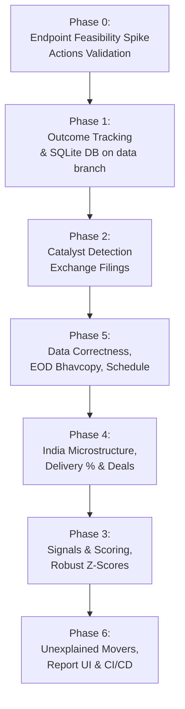

# Insider Activity Scanner — Engineering Roadmap & Implementation Plan

## Executive Summary
This document outlines the architectural transformation of the **Insider Activity Scanner** (Indian mid/small-cap NSE equities) from an initial prototype into an institutional-grade, statistically rigorous, and resilient market intelligence system.

---

## Architecture & Workflow Strategy

### Branching & Environment Rules
* **Branch Strategy**: Development is executed strictly on `feature/scanner-upgrade`. The `main` branch is untouched and unmerged by automated tasks.
* **Persistent State**: The `data` orphan branch is the single source of truth for `scanner.db` and master exports. Daily reports will not be committed to `main`.
* **Execution Budget**: Designed for `ubuntu-latest` within GitHub's free tier (target < 1,000 Actions minutes/month), with explicit per-job timeouts and runtime logging.
* **Network & Feasibility**: Every external endpoint (NSE/BSE/Bhavcopy) is validated from GitHub Actions runners in Phase 0 before building dependent phases.

---

## Phased Implementation Sequence

### Phase 0: Endpoint Feasibility Spike (Actions Runner)
**Objective**: Empirically verify every prospective NSE/BSE public endpoint, Bhavcopy URL, and RSS feed from a GitHub Actions `ubuntu-latest` runner to detect geo-blocking, Akamai challenges, or IP bans before writing application logic.

1. **Test Matrix Script (`scripts/test_endpoints.py`)**:
   * **NSE Bhavcopy**:
     * Current format EOD full bhavcopy: `https://archives.nseindia.com/products/content/sec_bhavdata_full_<DDMMYYYY>.csv`
     * PR zip / Daily bhavcopy formats.
   * **NSE Index Lists**:
     * `https://archives.nseindia.com/content/indices/ind_nifty100list.csv`
     * `https://archives.nseindia.com/content/indices/ind_niftymidcap150list.csv`
     * `https://archives.nseindia.com/content/indices/ind_niftysmallcap250list.csv`
   * **NSE Corporate Announcements**:
     * `https://www.nseindia.com/api/corporate-announcements?index=equities`
     * Board meetings: `https://www.nseindia.com/api/corporates-board-meetings`
     * Session cookie bootstrap: `https://www.nseindia.com/`
   * **BSE Corporate Announcements (Fallback)**:
     * `https://api.bseindia.com/BseIndiaAPI/api/AnnSubCategoryGetData/w`
     * BSE Bhavcopy / Scrip master.
   * **NSE Bulk & Block Deals**:
     * `https://archives.nseindia.com/content/equities/bulk.csv`
     * `https://archives.nseindia.com/content/equities/block.csv`
   * **Surveillance Lists (ASM / GSM)**:
     * Short-term / Long-term ASM & GSM lists on NSE.
   * **Google News RSS**:
     * Google News RSS query responses via `gnews` / `urllib`.
   * **yfinance Data Feed**:
     * Pricing and fast_info lookups.
2. **Throwaway GitHub Actions Workflow (`.github/workflows/feasibility_spike.yml`)**:
   * Triggers via `workflow_dispatch` on `feature/scanner-upgrade`.
   * Runs on `ubuntu-latest`.
   * Executes `scripts/test_endpoints.py` with standard headers, cookies, and rate-limits.
   * Logs HTTP status codes, latency, payload sizes, and header content-types, outputting a feasibility matrix markdown artifact.
3. **Review & Alternative Formulation**:
   * Stop for review. Any endpoint blocked or returning 403/Cloudflare/Akamai challenge from GitHub runners will be replaced with validated fallbacks (e.g., BSE API fallback, archives mirror, or yfinance fallback) before Phase 2/4/5.

---

### Phase 1: Outcome Tracking & Persistent Storage
**Objective**: Build a persistent evaluation loop measuring forward returns and hit rates against a benchmark and a random control sample.

1. **Storage Architecture (`output/scanner.db` on `data` branch)**:
   * Orphan `data` branch established as primary storage for `scanner.db` and exports.
   * Tables:
     * `flags`: `id`, `scan_date`, `symbol`, `company`, `industry`, `current_price`, `prev_close`, `price_change`, `current_volume`, `avg_volume_20d`, `volume_ratio`, `score`, `status`, `catalyst_state`, `delivery_pct`, `run_type` (`intraday`, `eod`), `is_control` (0 for flagged, 1 for control group), `created_at`.
     * Upsert constraint: `UNIQUE(symbol, scan_date, run_type)`.
     * `outcomes`: `id`, `flag_id`, `horizon_days` ($T+1, T+2, T+3, T+5, T+10$), `entry_price` (measured from **next-day open**), `forward_return`, `benchmark_return`, `excess_return`, `announcement_found`, `announcement_type`, `is_material`, `announcement_date`, `updated_at`.
2. **NSE Trading Holiday Calendar (`holidays.py`)**:
   * Hardcoded + API-refreshed calendar of NSE trading holidays to accurately compute trading-day steps ($T+N$) and skip pipeline runs on market holidays.
3. **Outcome Evaluator & Control Sample (`tracker.py`)**:
   * Evaluates flags $T+1$ to $T+10$ trading days old.
   * Forward return calculated from **next-day open** ($T+1$ Open) to evaluate tradability.
   * Samples a random 10-stock control group of unflagged universe constituents on each run to measure baseline lift (flagged precision vs. control group precision).
   * Distinguishes material filings (earnings, M&A, major orders) from routine/administrative filings.
4. **Report Integration**:
   * Hit-rate section in HTML report: precision of flags followed by material catalyst within 10 days, lift vs control group, forward excess return by score bucket.
5. **CLI & Migration**:
   * Add `python main.py --track`.
   * One-time migration script `scripts/migrate_csv_to_db.py` to ingest historical CSVs. Keep existing CSV filenames/columns for backward compatibility alongside renamed exports.

---

### Phase 2: Catalyst Detection from Exchange Filings
**Objective**: Primary catalyst classification from exchange disclosures, supplemented by Google News.

1. **Filing Ingestion (`filings.py`)**:
   * NSE corporate announcements API (with BSE fallback validated in Phase 0).
   * Categorization into Material Corporate Actions (Results, Board Intimations, Orders, Fund Raising, M&A, SAST/PIT).
2. **Three-Valued Catalyst Classification**:
   * State: `CATALYST` / `UNCLEAR` / `NONE`.
   * Filings are primary; Google News is secondary.
   * Catalyst state is kept as a separate classification field, not merged into the composite statistical score.
3. **Testable Benchmark Fixture**:
   * 40+ headline fixture file (`tests/fixtures/headlines.json`) with unit tests for false positives and false negatives.
4. **Pre-announcement Check**:
   * Radar for upcoming board meeting intimations scheduled in the next 7 calendar days.

---

### Phase 5: Data Correctness & Scheduling
*(Executed before Phase 4 & 3 so signal modeling is built on clean, validated EOD data)*

1. **Corporate Action Adjustment**:
   * Adjust historical prices for stock splits, bonuses, and rights.
   * Exclude or tag stocks within 2 business days of an ex-date.
2. **Bhavcopy as Primary EOD, yfinance as Fallback**:
   * Clean validation layer (check missing candles, stale timestamps, zero volume).
   * Audit log of skipped symbols.
3. **Dual-Tier Schedule with Actions Drift Awareness**:
   * Intraday run at 14:30 IST (early alert) and main EOD run at 17:00 IST (with final Bhavcopy and delivery).
   * Explicit job timeouts (e.g. 15 minutes) and runtime logging to ensure monthly usage stays well within the 1,000-minute free tier budget.
4. **Dynamic Universe & Microcap Support**:
   * Script to update constituents from NiftyIndices semi-annual revisions with rank slice config and `--microcap` flag.

---

### Phase 4: India-Specific Market Microstructure Data
1. **NSE Bhavcopy Delivery Data**:
   * Ingest official delivery quantity; compute Delivery % and 20-day rolling delivery z-score.
2. **Bulk & Block Deals**:
   * Parse daily bulk and block deals; match against flagged symbols and extract counterparties.
3. **Surveillance & Circuits**:
   * Ingest ASM/GSM surveillance lists and circuit bands (2%, 5%, 10%, 20%). Flag surveillance membership rather than dropping stocks.

---

### Phase 3: Better Signal and Scoring
1. **Residual-Volatility Return Z-Score**:
   * Abnormal return vs. index benchmark ($R_i - R_m$).
   * Normalized by stock's residual volatility (idiosyncratic volatility over 60 days).
2. **Robust Volume Z-Score & Intraday U-Curve**:
   * Volume baseline using median and MAD (Median Absolute Deviation) instead of mean/std:
     $$\text{Robust } Z_{vol} = \frac{\ln(V_t) - \text{median}(\ln(V_{20d}))}{1.4826 \cdot \text{MAD}(\ln(V_{20d}))}$$
   * Time-of-day normalization using empirical U-shaped intraday volume profile.
3. **Multi-day Creeping Accumulation**:
   * Cumulative abnormal return and volume over $t-10$ to $t-1$.
4. **Composite Score (0–100 Mapping)**:
   * Sigmoid / Min-Max normalized composite score mapping purely statistical factors (catalyst state kept separate).
   * Factor attribution breakdown per stock.
   * Walk-forward parameter calibration.
5. **Liquidity Filter & Deduplication**:
   * Turnover floor (ADTV in INR) and $N$-day suppression unless score spikes $\ge 20\%$.

---

### Phase 6: Reporting, Housekeeping & CI/CD
1. **Rebranding & Legal Disclaimer**:
   * Rename "Suspicious Movers" to "Unexplained Movers" across all files, templates, CLI, and exports.
   * Add disclaimer: *"Statistical screen only. Not evidence of wrongdoing. Not investment advice."*
2. **Dashboard UI Updates**:
   * Score breakdown, delivery %, forward return tracking, and direct links to exchange filings.
3. **Repository Cleanliness**:
   * Stop committing daily reports/CSVs to `main`. Sync SQLite DB and exports directly to the orphan `data` branch.
4. **CI/CD Pipeline**:
   * GitHub Actions workflow running `pytest` with coverage on every push to feature branches.
