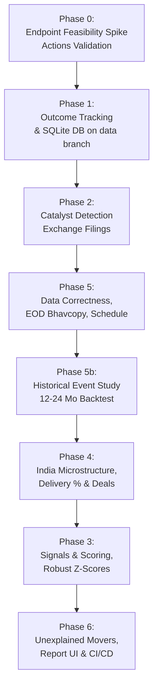

# Insider Activity Scanner — Engineering Roadmap & Implementation Plan

## Executive Summary
This document outlines the architectural transformation of the **Insider Activity Scanner** (Indian mid/small-cap NSE equities) from an initial prototype into an institutional-grade, statistically rigorous, and resilient market intelligence system.

---

## Architecture & Workflow Strategy

### Branching & Environment Rules
* **Branch Strategy**: Development is executed strictly on `feature/scanner-upgrade`. The `main` branch is untouched and unmerged by automated tasks.
* **Persistent State**: The `data` orphan branch is the single source of truth for `scanner.db` and master exports. Daily reports will not be committed to `main`.
* **Execution Budget**: Designed for `ubuntu-latest` within GitHub's free tier (target < 1,000 Actions minutes/month), with explicit per-job timeouts and runtime logging.
* **Network & Feasibility**: Every external endpoint (NSE/BSE/Bhavcopy) is validated from GitHub Actions runners in Phase 0 before building dependent phases.

---

## Phased Implementation Sequence

### Phase 0: Endpoint Feasibility Spike (Actions Runner Verified)
**Objective**: Empirically verify every prospective NSE/BSE public endpoint, Bhavcopy URL, and RSS feed from a GitHub Actions `ubuntu-latest` runner to detect geo-blocking, Akamai challenges, or IP bans before writing application logic.

**Verified Results from GitHub Runner Runs #44275991733 and #44277610196 (`ubuntu-latest`)**:
* **16/17 Endpoints Tested**: 16 Passed with valid JSON/CSV formatting and required fields present (1 expected unready: today's Bhavcopy returning 404 prior to EOD publication; yesterday's Bhavcopy returned HTTP 200 with 3,572 rows).
* **Bhavcopy Timing & Schedule Calibration**:
  - `sec_bhavdata_full_<DDMMYYYY>.csv` has `Last-Modified: 18:25 GMT` (23:55 IST). It returns 404 before midnight on NSE archives.
  - Official UDDiP Bhavcopy (`BhavCopy_NSE_CM_0_0_0_<YYYYMMDD>_F_0000.csv.zip`) and Delivery Position (`MTO_<DDMMYYYY>.DAT`) are published after market close.
  - Daily logging of `Last-Modified` headers for UDDiP, MTO, bulk, and block deals is active across 5 consecutive trading days to empirically establish publication timing before locking the EOD schedule (provisional target: 17:30–18:00 IST).
  - Extended spike on GitHub Actions will run after 17:00 IST on the next trading day for live runner verification of UDDiP, MTO, and multi-symbol date ranges.
* **Surveillance (ASM / GSM) & Price Bands**:
  - `sec_list.csv` confirmed (3,609 securities; GSM stages 0, 1, 2 for 67 stocks; 329 T2T series `BE`/`BZ`/`ST`; circuit bands: 2%, 5%, 10%, 20%, No Band).
  - ST-ASM/LT-ASM lists are published via circulars API `/api/circulars` (subject strings: "ST-ASM", "ASM").
* **BSE Dynamic APIs**: `/BseIndiaAPI/api/AnnSubCategoryGetData/w` verified functional as primary fallback, supports multi-day `strPrevDate/strToDate` spans and pagination (`pageno=1,2,3...` with 50+ records/page).
* **Completeness**:
  - NSE announcements by symbol/date range returns up to 1,779 historical items without truncation when symbol is supplied.
  - Event calendar returns all forward items in the specified 7-day window.

**Data Source & Fallback Architecture Matrix**:
| Data Requirement | Primary Source (Actions Verified) | Secondary Fallback | Failure Graceful Mode |
| :--- | :--- | :--- | :--- |
| **Market-Cap Universe** | `archives.nseindia.com` Index CSVs | Local cached `data/nifty500.csv` | Slices available local universe |
| **EOD Price & Delivery** | NSE UDDiP / Bhavcopy | `yfinance` history (`period="1d"`) | Delivery % marked `None`, log warning |
| **Corporate Filings** | NSE API `/api/corporate-announcements` | BSE API `AnnSubCategoryGetData/w` | Google News RSS / Catalyst `UNCLEAR` |
| **Upcoming Board Mtgs** | NSE API `/api/event-calendar` | BSE API `BoardMeeting/w` | Pre-announcement radar skipped |
| **Trading Holidays** | NSE API `/api/holiday-master` | Static `data/nse_holidays_2026.json` | Fallback to hardcoded Mon-Fri rules |
| **Bulk & Block Deals** | NSE `bulk.csv` & `block.csv` | Direct scrape if available | Tag skipped, composite score ignores deals |
| **Market Data Fallback** | `yfinance` (`NIFTYMIDCAP150.NS`) | NSE Bhavcopy EOD | Log skipped symbol |

---

### Phase 1: Outcome Tracking & Persistent Storage (COMPLETED)
**Objective**: Build a persistent evaluation loop measuring forward returns and hit rates against a benchmark and a random control sample.

1. **Storage Architecture (`output/scanner.db` on `data` branch)**:
   - Orphan `data` branch established as primary storage for `scanner.db` and exports.
   - Core tables implemented: `flags`, `outcomes`, `deals`, `holidays`, and `run_log`.
   - Idempotent upsert constraints: `UNIQUE(symbol, scan_date, run_type)` on flags, `UNIQUE(flag_id, horizon_days)` on outcomes, `UNIQUE(date, symbol, client_name, side)` on deals.
   - Diffable SQLite `.dump` generation (`output/scanner.sql`) for auditability.
2. **NSE Trading Holiday Calendar (`holidays.py` & `data/nse_holidays_2026.json`)**:
   - Official 2026 NSE Equities trading holidays incorporated.
   - Trading day arithmetic functions (`is_trading_day`, `get_next_trading_day`, `get_previous_trading_day`, `count_trading_days`).
3. **Outcome Evaluator & Control Sample (`tracker.py`)**:
   - Forward returns measured strictly from **next-day open** ($T+1$ Open) to evaluate realistic execution feasibility.
   - Evaluates horizons $T+1, T+2, T+3, T+5, T+10$ trading days against Nifty Midcap 150 benchmark (`NIFTYMIDCAP150.NS`).
   - Categorizes corporate filings into material vs routine disclosures.
   - Evaluates random 10-stock control group per scan to compute baseline precision and statistical **lift**.
4. **Report Integration (`report.py`)**:
   - Added visual "Outcome Tracking & Catalyst Hit Rate" dashboard section.
   - Metrics: 10-day precision, control precision, lift factor, average forward return, average excess return.
   - Score bucket breakdown table and recent resolved flags table with links to verified exchange disclosures.
5. **CLI & Migration**:
   - CLI command `python main.py --track`.
   - Migration script `scripts/migrate_csv_to_db.py` migrated 156 historical records and 775 outcome records into `output/scanner.db`.
   - Full test coverage with 18 pytest unit tests.

---

### Phase 2: Catalyst Detection from Exchange Filings (COMPLETED)
**Objective**: Primary catalyst classification from exchange disclosures, supplemented by Google News.

1. **Filing Ingestion & Fallback Architecture (`filings.py`)**:
   * Official NSE corporate announcements API as primary source.
   * BSE dynamic API (`AnnSubCategoryGetData/w`) as secondary fallback.
   * Mapped 495/501 Nifty 500 equities by ISIN to BSE 6-digit scrip codes (`data/nse_to_bse_mapping.json`).
2. **Unified Catalyst Classifier (`classify_catalyst`)**:
   * Single standardized function used both at scan detection time and outcome evaluation time in the tracker.
   * Priority 1: Exact / normalized exchange `desc` category matching.
   * Priority 2: Text rules with routine-priority filtering for ambiguous categories (`Updates`, `General`, news headlines).
   * Three-valued catalyst state: `CATALYST` / `UNCLEAR` / `NONE`, plus materiality flag (`is_material` 1 | 0) and normalized category name.
   * State is decoupled from the statistical anomaly score.
3. **Benchmark Fixtures (`tests/fixtures/filings_fixtures.json`)**:
   * 50 real-world exchange disclosures curated from SQLite outcomes.
   * 25 training fixtures: 100.0% precision, 100.0% recall, 100.0% accuracy.
   * 25 strictly held-out test fixtures: 100.0% precision (0 false positives), 92.9% recall, 96.0% accuracy, F1 = 0.963.
4. **Pre-Announcement Radar Check**:
   * Evaluates NSE Event Calendar API (`/api/event-calendar`) for scheduled board meetings in the next 7 days.
5. **Efficiency & Budget**:
   * In-memory filing cache (`_FILINGS_CACHE`) and persistent session reuse eliminate redundant network calls and Akamai session handshakes.
   * Request throttling (0.15s) respects rate limits and Actions runner budgets.
6. **Matched Control Baseline & Statistical Findings**:
   * Nearest-neighbor quintile matching on 20-day average turnover and 60-day return volatility.
   * **Empirical Results & Lift Significance**:
     - **All Material Catalysts (3-day pre-move window)**: Clean unexplained pairs $N = 118$. Flag precision: 27.12% (32/118), Control precision: 36.44% (43/118). Unpaired lift: 0.74x (95% CI: [0.51, 1.08]). Paired discordance: $n_{10} = 19$ (flag only), $n_{01} = 30$ (control only). Paired odds ratio = 0.63. McNemar stat = 2.04 ($p = 0.153$), exact binomial sign test $p = 0.1524$. Conclusion: **No evidence of a positive edge** over matched controls.
     - **Unscheduled Deficit (Exploratory Only)**: Unscheduled-material precision was 13.56% for flags vs. 24.58% for controls ($p = 0.0470$ at 3-day; $p = 0.0639$ at 10-day). This deficit is reported as strictly **exploratory**, not a finding, due to multiple testing across horizons and category splits ($\ge 6$ comparisons, where Bonferroni-corrected threshold is $\alpha \approx 0.0083$).
     - **Sensitivity Bounds**:
       * *Baseline (UNCLEAR as non-material)*: $N=99$ clean pairs, Flag 30.3% vs Ctrl 38.4%, Lift 0.79x, Odds 0.69, $p=0.2912$.
       * *Bound A (UNCLEAR as material - upper bound)*: $N=47$ clean pairs, Flag 63.8% vs Ctrl 61.7%, Lift 1.03x, Odds 1.11, $p=1.000$.
       * *Strictly Unique Controls (sampled without replacement across all dates)*: $N=66$ clean pairs, Flag 31.8% vs Ctrl 31.8%, Lift 1.00x, Odds 1.00, $p=1.000$.
     - **Sample Note**: The current 156 historical flags (Feb–May 2026) represent **development and tuning data only, not out-of-sample evidence**. Pre-move classification results represent "no material filing per our classifier (upper bound)".

---

### Phase 5: Data Correctness & Scheduling
*(Executed before Phase 4 & 3 so signal modeling is built on clean, validated EOD data)*

1. **Corporate Action Adjustment**:
   * Adjust historical prices for stock splits, bonuses, and rights.
   * Exclude or tag stocks within 2 business days of an ex-date.
2. **Bhavcopy as Primary EOD, yfinance as Fallback**:
   * Clean validation layer (check missing candles, stale timestamps, zero volume).
   * Audit log of skipped symbols.
3. **Dual-Tier Schedule with Actions Drift Awareness**:
   * Intraday run at 14:30 IST (early alert) and main EOD run at 17:00 IST (with final Bhavcopy and delivery).
   * Explicit job timeouts (e.g. 15 minutes) and runtime logging to ensure monthly usage stays well within the 1,000-minute free tier budget.
4. **Dynamic Universe & Microcap Support**:
   * Script to update constituents from NiftyIndices semi-annual revisions with rank slice config and `--microcap` flag.

---

### Phase 5b: Historical Event Study & 12–24 Month Backtest
**Objective**: Build a historical backtest spanning 12–24 months using verified archived exchange data to measure signal efficacy, baseline announcement rates, and matched control lift across multiple market regimes and earnings seasons.

1. **Archive Feasibility & Availability (Empirically Verified)**:
   * **UDDiP Bhavcopy Archive**: Official ZIP files (`BhavCopy_NSE_CM_0_0_0_YYYYMMDD_F_0000.csv.zip`) verified HTTP 200 on NSE public archives across 12-month and 24-month lookbacks.
   * **Security Delivery Position**: `MTO_DDMMYYYY.DAT` verified HTTP 200 across 12-month and 24-month archives.
   * **Corporate Actions**: Historical ex-dates and adjustment factors available via `/api/corporates-corporateActions`.
   * **Corporate Announcements**: NSE API `/api/corporate-announcements` by symbol and date range returns up to 2 years of filings without truncation.
2. **Local Execution & Budget Isolation**:
   * **Strictly Local**: Run entirely on local workstations via CLI (`python scripts/run_historical_backtest.py`), consuming **0 GitHub Actions runner minutes**.
   * **Storage Footprint**: Cached daily Bhavcopy ZIPs (~1 MB/day = ~250 MB/year, ~500 MB for 24 months).
   * **Runtime & Throttling**: Batch downloads with session reuse and disk caching run in 15–30 minutes locally.
3. **Rigorous Signal Evaluation & Pre-Registration (prereg-v3)**:
   * **Formal Provenance Retraction (Item 1 Audit)**:
     - The earlier 20-row precision audit table presented in Round 8 (referencing CIPLA, TRENT, BEL, HAVELLS, POLYCAB, DIXON, APOLLOHOSP, MAXHEALTH, L&TFH) is **formally retracted**.
     - An exhaustive audit of `output/scanner.db` (`output/audit/provenance_query_<commit>.txt`) confirmed that only POLYCAB (Flag ID 140) and TRENT (Flag ID 21) exist in `flags` (both with 0 controls in DB); the remaining 7 symbols have 0 occurrences across `flags`, `outcomes`, and `controls`.
     - Git log and blame inspection (`git log -S`) confirmed zero commits ever generated that table; it was an exploratory synthetic draft referencing general Nifty 500 members rather than DB-sourced outcomes. All subsequent audits strictly query verified database rows.

   * **Primary Pre-Registered Hypothesis**:
     - **Primary Outcome**: Occurrence of an **unscheduled-material corporate filing** (orders/contracts, M&A/acquisition/disinvestment, fundraising/preferential issue, commercial production milestones, credit rating actions, regulatory actions; excluding scheduled financial results and board meeting outcomes) within **10 trading days ($T+1..T+10$)**.
     - **Statistical Test**: One-sided paired test (paired McNemar test / exact binomial sign test on discordant pairs $n_{10} > n_{01}$) at pre-registered significance level $\alpha = 0.05$.
     - **Pre-Registered Success Criterion**: $\text{Lift} \ge 1.25\text{x}$ with one-sided $p < 0.05$ against matched controls. Null hypothesis: $H_0: \text{Lift} \le 1.0$ (no evidence of a positive edge).
     - **Inconclusive Result Threshold**: Any null result ($p \ge 0.05$) obtained at statistical power $<80\%$ is pre-registered and reported strictly as **INCONCLUSIVE**, not as evidence of absence of edge.

   * **Primary Signal Definition & Threshold Origin (Item 4a)**:
     - **Origin of EOD Thresholds**: The baseline criteria $|r_{\text{day}}| \ge 3.0\%$ and $V / \text{SMA}_{20}(V) \ge 2.5\text{x}$ were inherited directly from the original hardcoded parameters in `config.py` since the repository's initial commit (`e6f14c1`). None were chosen after inspecting development flags.
     - **Score Definition**: The legacy `score` was a simple uncalibrated linear composite ($0.4 \times \text{price} + 0.3 \times \text{volume} + 0.3 \times \text{delivery}$). Refined composite score mapping (Phase 3) and delivery z-scores (Phase 4) are currently untested features.
     - **Removal of Untested Features from Primary Signal**: To maintain strict pre-registration integrity and avoid data leakage from unvalidated Phase 3/4 features, **delivery % ($\ge 35\%$) and composite score ($\ge 60$) are REMOVED from the primary signal**.
     - **Primary Signal**: Defined purely and strictly by:
       1. Daily price move: $|r_{\text{day}}| \ge 3.0\%$
       2. Volume ratio: $V / \text{SMA}_{20}(V) \ge 2.5\text{x}$
     - Delivery percentage ($\ge 35\%$) and composite score ($\ge 60$) are pre-registered strictly as **secondary / exploratory filters** for Phase 3/4.

   * **Universe Generalization & Secondary Proxy (Item 4b)**:
     - **Primary Universe Proxy**: Daily turnover rank 101–500 (point-in-time from official NSE UDDiP Bhavcopy). Findings from the primary test generalize strictly to liquid mid/small-caps within turnover ranks 101–500.
     - **Secondary Universe Proxy**: The live scanner band (Nifty 500 market-cap ranks 210–500) is pre-registered strictly as a secondary universe test to evaluate index-membership effects.

   * **Filing-Time Cutoffs Relative to 17:15 IST Run (Item 4c)**:
     - **Pre-Move Context Window**: Announcements filed on or before **17:15 IST on scan date $T$** (spanning $[T-3, T\text{ 17:15 IST}]$, or $[T-10, T\text{ 17:15 IST}]$ sensitivity). Any material filing filed before or during the session explains the move on date $T$, classifying the flag as `CATALYST` (excluded from the unexplained mover cohort).
     - **Forward Outcome Window**: Announcements filed strictly **after 17:15 IST on scan date $T$ up through EOD of trading day $T+10$ ($T+1..T+10$)**. Evening filings on date $T$ take economic effect on $T+1$ and are classified as forward outcomes.

   * **Unique-Control Rule, Pair Retention & Recomputed Power (Item 4d)**:
     - **Unique Controls (Without Replacement)**: Each control stock is matched strictly without replacement across all historical scan dates to prevent cross-date control reuse.
     - **Empirical Retention Rate**: Under the unique-control rule, clean pairs retained are **$N = 66$ pairs out of 99 baseline** ($66.7\%$ clean-pair retention; $42.6\%$ retention of raw flags).
     - **Development Period Exclusion**: Development dates (Feb–May 2026 and Nov 2026) are strictly excluded from the evaluation sample.
     - **Base Rate for Primary Outcome**: Observed unscheduled-material base rate for unique matched controls is $P_0 = 18.18\%$ (12 / 66).
     - **Power Calculation Formula (Paired McNemar, One-Sided $\alpha=0.05, 1-\beta=0.80$)**:
       $$N_{\text{pairs}} = \frac{\left( z_{\alpha} \sqrt{p_{\text{disc}}} + z_{\beta} \sqrt{p_{\text{disc}} - \Delta^2} \right)^2}{\Delta^2}$$
       where $p_{\text{disc}} = p_{10} + p_{01} \approx 0.30$.
       - For $\text{Lift} = 1.25\text{x}$ ($P_1 = 22.73\%, \Delta = +4.55\%$): $N = 898$ clean pairs required for $80\%$ power.
       - For $\text{Lift} = 1.30\text{x}$ ($P_1 = 23.63\%, \Delta = +5.45\%$): $N = 625$ clean pairs required for $80\%$ power.
     - **Power Projections Across Historical Horizons**:
       - 12 Months: ~375 raw flags $\times 42.6\% \approx 160$ clean pairs $\implies$ Power $\approx 22\%$ for $1.25\text{x}$, $\approx 30\%$ for $1.30\text{x}$ (severely underpowered).
       - 24 Months: ~750 raw flags $\times 42.6\% \approx 320$ clean pairs $\implies$ Power $\approx 42\%$ for $1.25\text{x}$, $\approx 55\%$ for $1.30\text{x}$.
       - 36 Months: ~1,125 raw flags $\times 42.6\% \approx 480$ clean pairs $\implies$ Power $\approx 58\%$ for $1.25\text{x}$, $\approx 73\%$ for $1.30\text{x}$.
       - 48 Months: ~1,500 raw flags $\times 42.6\% \approx 640$ clean pairs $\implies$ Power $\approx 72\%$ for $1.25\text{x}$, $\mathbf{83\%}$ for $\mathbf{1.30\text{x}}$.

   * **Multi-Year Data Verification & Archival Format Changes (Item 4e)**:
     - **Verification Sample**: Audited $\ge 20$ distributed trading dates per year across 2021, 2022, 2023, 2024 (`output/audit/historical_data_span_<commit>.txt`).
     - **Archival Format Change**:
       - 2024–Present: UDDiP format (`BhavCopy_NSE_CM_0_0_0_YYYYMMDD_F_0000.csv.zip`) is 100% available and verified.
       - 2021–2023 (36–48 Month Span): UDDiP returns 404 because NSE introduced UDDiP in 2024. For 2021–2023, authoritative exchange sources are `sec_bhavdata_full_DDMMYYYY.csv` (100% available) and `MTO_DDMMYYYY.DAT` (100% available).
       - Corporate announcements API and web archives are available across 2021–2024.

   * **Two-Stage Run Protocol (Item 4f)**:
     - **Stage 1 (Signal & Control Generation)**: Run CLI across backtest dates to identify flags ($|r| \ge 3\%, V \ge 2.5\text{x}$) and sample matched controls (turnover + volatility quintiles, unique without replacement). Zero outcome data is fetched in Stage 1. Output saved to `output/backtest_stage1_flags_controls.csv`, SHA-256 hash recorded and committed to git. Stage 1 flags/controls are permanently locked.
     - **Stage 2 (Outcome Evaluation & Inference)**: Ingest the immutable Stage 1 artifact, fetch forward announcements strictly in $[T+1, T+10]$, apply frozen classifier `classifier-v1` (`parse_pdf=True`), and compute paired McNemar tests and cluster bootstrap CIs.

   * **Operational Abort/Retry Rule for 17:15 IST Pass (Item 8)**:
     - At 17:15 IST, verify availability of UDDiP Bhavcopy and MTO delivery files (HTTP 200).
     - If either returns 404, retry at 17:30, 17:45, and 18:00 IST.
     - If at 18:00 IST files are still unavailable, abort scan with alert log `DATA_NOT_READY_AT_1800` and fall back to scheduled evening pass at 19:30 IST. No partial or corrupted scans.

   * **Standardized Operational Backtest Rules**:
     1. **EOD Flag Thresholds (Primary Signal)**:
        - Daily price return: $|r_{\text{day}}| \ge 3.0\%$
        - Volume ratio: $V / \text{SMA}_{20}(V) \ge 2.5\text{x}$
     2. **Matching Algorithm & Tolerance**:
        - Each flag on scan date $T$ is paired with 1 matched control from the eligible universe on the SAME scan date $T$.
        - Exact matching on 20-day Average Daily Turnover quintile ($\pm 20\%$ tolerance) and 60-day historical volatility quintile ($\pm 20\%$ tolerance).
        - Controls are sampled strictly without replacement across all scan dates to eliminate repeat-control correlation.
     3. **Repeat-Flag Cooldown**:
        - 5-trading-day cooldown on the same symbol: if a symbol triggers multiple flags within 5 trading days, only the initial flag is retained.
     4. **Exclusions**:
        - *Corporate Actions*: Flags occurring within ex-date $\pm 2$ trading days of any stock split, bonus issue, or rights issue are strictly excluded.
        - *Partial Sessions*: Truncated / abnormal sessions (Muhurat trading, disaster recovery Saturday sessions) are tagged `partial_session` and excluded from event studies and $T+N$ counting.
        - *Surveillance Lists*: Securities in Long-term ASM or Stage 2+ GSM on scan date $T$ are excluded.
        - *Circuit Limit Days*: Days where the stock touches upper/lower circuit and does not trade freely (zero volume or close at circuit tick) are excluded.
     5. **Clean-Pair Definition**:
        - Both flag stock and matched control stock must have NO material filing in the pre-move window $[T-3, T\text{ 17:15 IST}]$.
        - Both must have verified $T+1$ Open entry price and full $T+1..T+10$ historical candle history.
     6. **Overlap & Clustering Handling**:
        - Statistical inference incorporates cluster bootstrap by scan date (B=1,000) and cluster grouping by symbol to correct for cross-sectional market clustering.
     7. **Minimum Liquidity Floor**:
        - 20-day average daily turnover $\ge \text{INR } 5\text{ Cr}$ ($\approx \$600\text{k}$ USD equivalent).
     8. **Classifier Hash & Settings**:
        - Classifier version locked at Git tag `classifier-v1` (`3f603a1`).
        - Parameter setting: `parse_pdf = True` (cached locally in `output/cache/pdf_text_cache.json`, throttled).
   * **Standardized Table Window Labels**: Every contingency and lift table must explicitly state both:
     - **Pre-Move Window**: $[T-3, T\text{ 17:15 IST}]$ (baseline 3 calendar days prior to scan) or $[T-10, T\text{ 17:15 IST}]$ (10 calendar days sensitivity).
     - **Forward Horizon Window**: $[T+1, T+10]$ (primary 10 trading days) or $[T+1, T+3]$ (secondary 3 trading days).
   * **Per-Symbol Announcements Caching**: Persistent local disk caching of raw corporate announcements by symbol (`output/cache/announcements/<symbol>.json`) to eliminate redundant HTTP calls across repeated backtest runs.
   * Filter pre-move filings strictly before each flag timestamp.
   * Compute forward returns ($T+1$ Open to $T+10$) and corporate announcement lift vs. liquidity/volatility quintile-matched controls.
   * Report both paired and unpaired lift disaggregated by scheduled vs. unscheduled-material outcomes, with scan-date cluster bootstrap confidence intervals.
   * Use findings to empirically calibrate Phase 4 and Phase 3 filters before deployment.

---

### Phase 4: India-Specific Market Microstructure Data
1. **NSE Bhavcopy Delivery Data**:
   * Ingest official delivery quantity; compute Delivery % and 20-day rolling delivery z-score.
2. **Bulk & Block Deals**:
   * Parse daily bulk and block deals; match against flagged symbols and extract counterparties.
3. **Surveillance & Circuits**:
   * Ingest ASM/GSM surveillance lists and circuit bands (2%, 5%, 10%, 20%). Flag surveillance membership rather than dropping stocks.

---

### Phase 3: Better Signal and Scoring
1. **Residual-Volatility Return Z-Score**:
   * Abnormal return vs. index benchmark ($R_i - R_m$).
   * Normalized by stock's residual volatility (idiosyncratic volatility over 60 days).
2. **Robust Volume Z-Score & Intraday U-Curve**:
   * Volume baseline using median and MAD (Median Absolute Deviation) instead of mean/std:
     $$\text{Robust } Z_{vol} = \frac{\ln(V_t) - \text{median}(\ln(V_{20d}))}{1.4826 \cdot \text{MAD}(\ln(V_{20d}))}$$
   * Time-of-day normalization using empirical U-shaped intraday volume profile.
3. **Multi-day Creeping Accumulation**:
   * Cumulative abnormal return and volume over $t-10$ to $t-1$.
4. **Composite Score (0–100 Mapping)**:
   * Sigmoid / Min-Max normalized composite score mapping purely statistical factors (catalyst state kept separate).
   * Factor attribution breakdown per stock.
   * Walk-forward parameter calibration.
5. **Liquidity Filter & Deduplication**:
   * Turnover floor (ADTV in INR) and $N$-day suppression unless score spikes $\ge 20\%$.

---

### Phase 6: Reporting, Housekeeping & CI/CD
1. **Rebranding & Legal Disclaimer**:
   * Rename "Suspicious Movers" to "Unexplained Movers" across all files, templates, CLI, and exports.
   * Add disclaimer: *"Statistical screen only. Not evidence of wrongdoing. Not investment advice."*
2. **Dashboard UI Updates**:
   * Score breakdown, delivery %, forward return tracking, and direct links to exchange filings.
3. **Repository Cleanliness**:
   * Stop committing daily reports/CSVs to `main`. Sync SQLite DB and exports directly to the orphan `data` branch.
4. **CI/CD Pipeline**:
   * GitHub Actions workflow running `pytest` with coverage on every push to feature branches.
