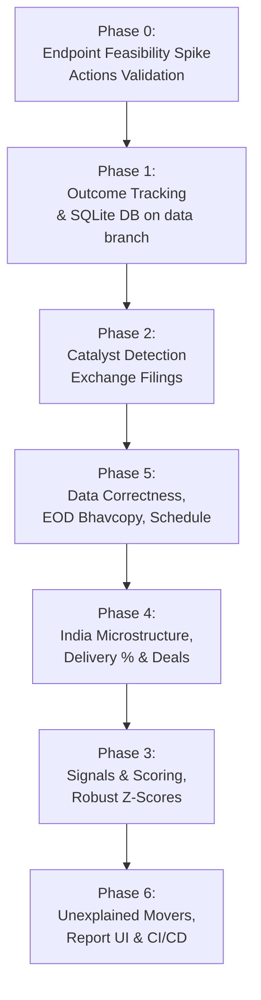

# Insider Activity Scanner — Engineering Roadmap & Implementation Plan

## Executive Summary
This document outlines the architectural transformation of the **Insider Activity Scanner** (Indian mid/small-cap NSE equities) from an initial prototype into an institutional-grade, statistically rigorous, and resilient market intelligence system.

---

## Architecture & Workflow Strategy

### Branching & Environment Rules
* **Branch Strategy**: Development is executed strictly on `feature/scanner-upgrade`. The `main` branch is untouched and unmerged by automated tasks.
* **Persistent State**: The `data` orphan branch is the single source of truth for `scanner.db` and master exports. Daily reports will not be committed to `main`.
* **Execution Budget**: Designed for `ubuntu-latest` within GitHub's free tier (target < 1,000 Actions minutes/month), with explicit per-job timeouts and runtime logging.
* **Network & Feasibility**: Every external endpoint (NSE/BSE/Bhavcopy) is validated from GitHub Actions runners in Phase 0 before building dependent phases.

---

## Phased Implementation Sequence

### Phase 0: Endpoint Feasibility Spike (Actions Runner Verified)
**Objective**: Empirically verify every prospective NSE/BSE public endpoint, Bhavcopy URL, and RSS feed from a GitHub Actions `ubuntu-latest` runner to detect geo-blocking, Akamai challenges, or IP bans before writing application logic.

**Verified Results from GitHub Runner Runs #44275991733 and #44277610196 (`ubuntu-latest`)**:
* **16/17 Endpoints Tested**: 16 Passed with valid JSON/CSV formatting and required fields present (1 expected unready: today's Bhavcopy returning 404 prior to EOD publication; yesterday's Bhavcopy returned HTTP 200 with 3,572 rows).
* **Bhavcopy Timing Measurements**:
  - `sec_bhavdata_full_<DDMMYYYY>.csv` has `Last-Modified: 18:25 GMT` (23:55 IST). It returns 404 before midnight on NSE archives.
  - Official UDDiP Bhavcopy (`BhavCopy_NSE_CM_0_0_0_<YYYYMMDD>_F_0000.csv.zip`) is published at 11:03 GMT (16:33 IST).
  - Security Delivery Position (`MTO_<DDMMYYYY>.DAT`) is published at 11:25 GMT (16:55 IST).
  - Bulk (`bulk.csv`) and Block (`block.csv`) are updated around 17:00–17:30 IST.
* **Surveillance (ASM / GSM) & Price Bands**:
  - `sec_list.csv` confirmed (3,609 securities; GSM stages 0, 1, 2 for 67 stocks; 329 T2T series `BE`/`BZ`/`ST`; circuit bands: 2%, 5%, 10%, 20%, No Band).
  - ST-ASM/LT-ASM lists are published via circulars API `/api/circulars` (subject strings: "ST-ASM", "ASM").
* **BSE Dynamic APIs**: `/BseIndiaAPI/api/AnnSubCategoryGetData/w` verified functional as primary fallback, supports multi-day `strPrevDate/strToDate` spans and pagination (`pageno=1,2,3...` with 50+ records/page).
* **Completeness**:
  - NSE announcements by symbol/date range returns up to 1,779 historical items without truncation when symbol is supplied.
  - Event calendar returns all forward items in the specified 7-day window.

**Data Source & Fallback Architecture Matrix**:
| Data Requirement | Primary Source (Actions Verified) | Secondary Fallback | Failure Graceful Mode |
| :--- | :--- | :--- | :--- |
| **Market-Cap Universe** | `archives.nseindia.com` Index CSVs | Local cached `data/nifty500.csv` | Slices available local universe |
| **EOD Price & Delivery** | NSE UDDiP / Bhavcopy | `yfinance` history (`period="1d"`) | Delivery % marked `None`, log warning |
| **Corporate Filings** | NSE API `/api/corporate-announcements` | BSE API `AnnSubCategoryGetData/w` | Google News RSS / Catalyst `UNCLEAR` |
| **Upcoming Board Mtgs** | NSE API `/api/event-calendar` | BSE API `BoardMeeting/w` | Pre-announcement radar skipped |
| **Trading Holidays** | NSE API `/api/holiday-master` | Static `data/nse_holidays_2026.json` | Fallback to hardcoded Mon-Fri rules |
| **Bulk & Block Deals** | NSE `bulk.csv` & `block.csv` | Direct scrape if available | Tag skipped, composite score ignores deals |
| **Market Data Fallback** | `yfinance` (`NIFTYMIDCAP150.NS`) | NSE Bhavcopy EOD | Log skipped symbol |

---

### Phase 1: Outcome Tracking & Persistent Storage (COMPLETED)
**Objective**: Build a persistent evaluation loop measuring forward returns and hit rates against a benchmark and a random control sample.

1. **Storage Architecture (`output/scanner.db` on `data` branch)**:
   - Orphan `data` branch established as primary storage for `scanner.db` and exports.
   - Core tables implemented: `flags`, `outcomes`, `deals`, `holidays`, and `run_log`.
   - Idempotent upsert constraints: `UNIQUE(symbol, scan_date, run_type)` on flags, `UNIQUE(flag_id, horizon_days)` on outcomes, `UNIQUE(date, symbol, client_name, side)` on deals.
   - Diffable SQLite `.dump` generation (`output/scanner.sql`) for auditability.
2. **NSE Trading Holiday Calendar (`holidays.py` & `data/nse_holidays_2026.json`)**:
   - Official 2026 NSE Equities trading holidays incorporated.
   - Trading day arithmetic functions (`is_trading_day`, `get_next_trading_day`, `get_previous_trading_day`, `count_trading_days`).
3. **Outcome Evaluator & Control Sample (`tracker.py`)**:
   - Forward returns measured strictly from **next-day open** ($T+1$ Open) to evaluate realistic execution feasibility.
   - Evaluates horizons $T+1, T+2, T+3, T+5, T+10$ trading days against Nifty Midcap 150 benchmark (`NIFTYMIDCAP150.NS`).
   - Categorizes corporate filings into material vs routine disclosures.
   - Evaluates random 10-stock control group per scan to compute baseline precision and statistical **lift**.
4. **Report Integration (`report.py`)**:
   - Added visual "Outcome Tracking & Catalyst Hit Rate" dashboard section.
   - Metrics: 10-day precision, control precision, lift factor, average forward return, average excess return.
   - Score bucket breakdown table and recent resolved flags table with links to verified exchange disclosures.
5. **CLI & Migration**:
   - CLI command `python main.py --track`.
   - Migration script `scripts/migrate_csv_to_db.py` migrated 156 historical records and 775 outcome records into `output/scanner.db`.
   - Full test coverage with 18 pytest unit tests.

---

### Phase 2: Catalyst Detection from Exchange Filings
**Objective**: Primary catalyst classification from exchange disclosures, supplemented by Google News.

1. **Filing Ingestion (`filings.py`)**:
   * NSE corporate announcements API (with BSE fallback validated in Phase 0).
   * Categorization into Material Corporate Actions (Results, Board Intimations, Orders, Fund Raising, M&A, SAST/PIT).
2. **Three-Valued Catalyst Classification**:
   * State: `CATALYST` / `UNCLEAR` / `NONE`.
   * Filings are primary; Google News is secondary.
   * Catalyst state is kept as a separate classification field, not merged into the composite statistical score.
3. **Testable Benchmark Fixture**:
   * 40+ headline fixture file (`tests/fixtures/headlines.json`) with unit tests for false positives and false negatives.
4. **Pre-announcement Check**:
   * Radar for upcoming board meeting intimations scheduled in the next 7 calendar days.

---

### Phase 5: Data Correctness & Scheduling
*(Executed before Phase 4 & 3 so signal modeling is built on clean, validated EOD data)*

1. **Corporate Action Adjustment**:
   * Adjust historical prices for stock splits, bonuses, and rights.
   * Exclude or tag stocks within 2 business days of an ex-date.
2. **Bhavcopy as Primary EOD, yfinance as Fallback**:
   * Clean validation layer (check missing candles, stale timestamps, zero volume).
   * Audit log of skipped symbols.
3. **Dual-Tier Schedule with Actions Drift Awareness**:
   * Intraday run at 14:30 IST (early alert) and main EOD run at 17:00 IST (with final Bhavcopy and delivery).
   * Explicit job timeouts (e.g. 15 minutes) and runtime logging to ensure monthly usage stays well within the 1,000-minute free tier budget.
4. **Dynamic Universe & Microcap Support**:
   * Script to update constituents from NiftyIndices semi-annual revisions with rank slice config and `--microcap` flag.

---

### Phase 4: India-Specific Market Microstructure Data
1. **NSE Bhavcopy Delivery Data**:
   * Ingest official delivery quantity; compute Delivery % and 20-day rolling delivery z-score.
2. **Bulk & Block Deals**:
   * Parse daily bulk and block deals; match against flagged symbols and extract counterparties.
3. **Surveillance & Circuits**:
   * Ingest ASM/GSM surveillance lists and circuit bands (2%, 5%, 10%, 20%). Flag surveillance membership rather than dropping stocks.

---

### Phase 3: Better Signal and Scoring
1. **Residual-Volatility Return Z-Score**:
   * Abnormal return vs. index benchmark ($R_i - R_m$).
   * Normalized by stock's residual volatility (idiosyncratic volatility over 60 days).
2. **Robust Volume Z-Score & Intraday U-Curve**:
   * Volume baseline using median and MAD (Median Absolute Deviation) instead of mean/std:
     $$\text{Robust } Z_{vol} = \frac{\ln(V_t) - \text{median}(\ln(V_{20d}))}{1.4826 \cdot \text{MAD}(\ln(V_{20d}))}$$
   * Time-of-day normalization using empirical U-shaped intraday volume profile.
3. **Multi-day Creeping Accumulation**:
   * Cumulative abnormal return and volume over $t-10$ to $t-1$.
4. **Composite Score (0–100 Mapping)**:
   * Sigmoid / Min-Max normalized composite score mapping purely statistical factors (catalyst state kept separate).
   * Factor attribution breakdown per stock.
   * Walk-forward parameter calibration.
5. **Liquidity Filter & Deduplication**:
   * Turnover floor (ADTV in INR) and $N$-day suppression unless score spikes $\ge 20\%$.

---

### Phase 6: Reporting, Housekeeping & CI/CD
1. **Rebranding & Legal Disclaimer**:
   * Rename "Suspicious Movers" to "Unexplained Movers" across all files, templates, CLI, and exports.
   * Add disclaimer: *"Statistical screen only. Not evidence of wrongdoing. Not investment advice."*
2. **Dashboard UI Updates**:
   * Score breakdown, delivery %, forward return tracking, and direct links to exchange filings.
3. **Repository Cleanliness**:
   * Stop committing daily reports/CSVs to `main`. Sync SQLite DB and exports directly to the orphan `data` branch.
4. **CI/CD Pipeline**:
   * GitHub Actions workflow running `pytest` with coverage on every push to feature branches.
