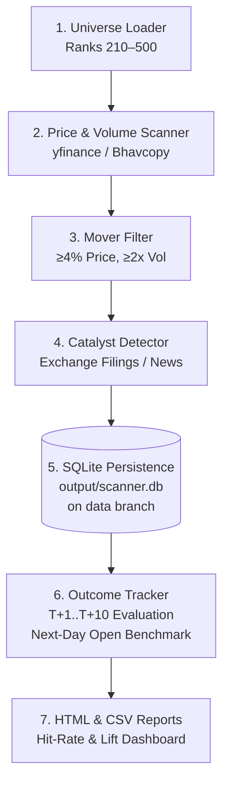

# Insider Activity Scanner — Indian Mid/Small-Cap NSE Equities

An automated statistical market surveillance engine that monitors Indian mid-cap and small-cap equities (market cap rank 210–500, Nifty Midcap 150 / Smallcap 250 universe) for anomalous volume and price moves, identifies potential pre-announcement insider activity, and tracks forward outcomes over a 10-day evaluation window.

---

## Architecture Overview



### Key Modules
- **`universe.py`**: Loads and caches Nifty 500 constituents and extracts the mid/small-cap target slice (ranks 210–500).
- **`scanner.py`**: Fetches batch EOD and intraday OHLCV price and volume data.
- **`filings.py`**: Primary catalyst ingestion and classification engine. Queries official NSE Corporate Announcements API with BSE API fallback, maps NSE symbols to BSE scrip codes via ISIN, provides 7-day pre-announcement board meeting radar, and executes the unified 3-valued catalyst classifier (`CATALYST` / `UNCLEAR` / `NONE`).
- **`news.py`**: Secondary catalyst verification via Google News RSS, sharing the unified classifier from `filings.py`.
- **`holidays.py`**: Official NSE trading holiday calendar providing accurate trading-day arithmetic ($T+N$) and skipping market holidays.
- **`db.py`**: SQLite database engine (`output/scanner.db`) operating with WAL mode, foreign keys, and idempotent upserts. Generates text `.dump` (`output/scanner.sql`) for diffable history.
- **`tracker.py`**: Evaluates flags from 1 to 15 trading days old. Forward returns are calculated strictly from **next-day open** ($T+1$ Open) to evaluate real-world tradability. Benchmarks returns against Nifty Midcap 150 (`NIFTYMIDCAP150.NS`) and tracks both random controls and turnover/volatility matched controls to measure statistical **lift**.
- **`corporate_actions.py`**: Corporate actions ingestion and ex-date proximity detector (+/- 2 trading days) to identify and adjust price drops/jumps from stock splits, bonus issues, and rights.
- **`bhavcopy.py`**: Official NSE UDDiP Bhavcopy (`BhavCopy_NSE_CM_0_0_0_YYYYMMDD_F_0000.csv.zip`) and Security Delivery Position (`MTO_DDMMYYYY.DAT`) ingestion module with graceful fallback to `yfinance`.
- **`data_quality.py`**: Market data validation layer that verifies candle consistency (detects missing candles, zero volume, inverted bounds, and unadjusted price discontinuities) and logs skipped symbols.
- **`report.py`**: Generates visual dark-theme HTML reports and master CSV exports (`suspicious_master.csv`, `news_driven_master.csv`, `unexplained_master.csv`).
- **`main.py`**: Central orchestrator and CLI entry point.

---

## Installation & Setup

1. **Clone the repository**:
   ```bash
   git clone https://github.com/maniarjimmy/insidertrading.git
   cd insidertrading
   ```

2. **Create and activate a virtual environment**:
   ```bash
   python -m venv .venv
   source .venv/bin/activate    # On Linux/macOS
   .venv\Scripts\activate       # On Windows
   ```

3. **Install dependencies**:
   ```bash
   pip install -r requirements.txt
   ```

---

## CLI Usage

### 1. Run Scan Immediately
```bash
python main.py
```

### 2. Run Outcome Tracker (T+1..T+10 Evaluation)
```bash
python main.py --track
```

### 3. Customize Scanner Thresholds
```bash
python main.py --min-pct 3.5 --min-vol-ratio 2.5
```

### 4. Schedule Daily Scan (Market Close)
```bash
python main.py --schedule
```

### 5. Run Integration Test
```bash
python test_integration.py
```

### 6. Run Unit Tests
```bash
pytest tests/ -v
```

---

## Storage & The `data` Branch Architecture

To prevent polluting git commit history with daily binary SQLite changes or hundreds of daily HTML reports, persistent state is managed on an orphan branch named **`data`**:
- **Source of truth for data**: `output/scanner.db` and master CSV exports live on the orphan `data` branch.
- **Diffable version history**: `output/scanner.sql` (generated via SQLite `.dump`) is committed alongside the binary DB.
- **Automated Monthly Squash**: Scheduled GitHub Actions job squashes the `data` branch history to a single commit every month, keeping repository size minimal.
- **Code branch separation**: The code branch (`feature/scanner-upgrade` / `main`) remains clean and code-only.

---

## Database Schema (`output/scanner.db`)

- **`flags`**: Upserted on `(symbol, scan_date, run_type)`. Tracks price change, volume ratio, score, status (`ACTIVE`, `RESOLVED`, `EXPIRED`), catalyst state (`CATALYST`, `UNCLEAR`, `NONE`), and `is_control` (0 = flagged, 1 = control group).
- **`outcomes`**: Upserted on `(flag_id, horizon_days)`. Records forward return from next-day open, benchmark excess return, and verified corporate announcements.
- **`deals`**: Upserted on `(date, symbol, client_name, side)`. Daily snapshot of NSE bulk and block deals.
- **`holidays`**: NSE trading holidays (2026 calendar).
- **`run_log`**: Execution audit log tracking source used, runtime, row counts, and status.

---

## Disclaimer
Statistical screen only. Not evidence of wrongdoing. Not investment advice. Use at your own risk.
